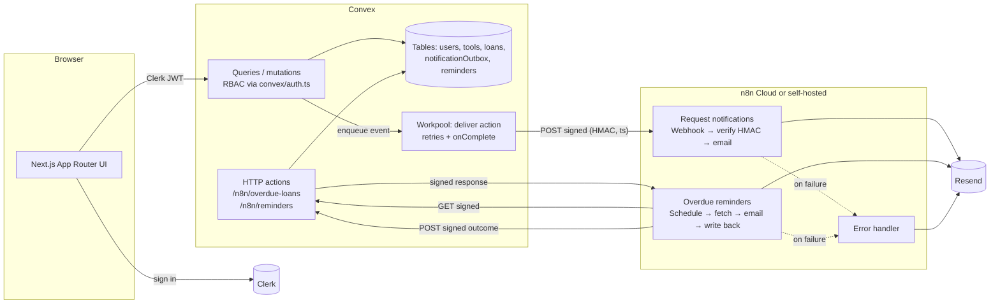

# LendLoop

A neighborhood tool-lending board. Neighbors list tools they're happy to lend, request to borrow each other's tools for a date range, and get notified by email. n8n handles request notifications and hourly overdue reminders.

*Borrow what you need. Lend what you don't.*

**Stack:** Next.js 16 (App Router), strict TypeScript, Clerk, Convex, n8n (Cloud, or self-hosted with the included `docker-compose.yml`), Resend (email through n8n).

## Contents

- [Features](#features)
- [Architecture](#architecture)
- [Local setup](#local-setup)
- [Environment variables](#environment-variables)
- [Roles and admin provisioning](#roles-and-admin-provisioning)
- [Security and data minimization](#security-and-data-minimization)
- [Reliability and error handling](#reliability-and-error-handling)
- [Decisions](#decisions)
- [Assumptions and what is not verified end to end](#assumptions-and-what-is-not-verified-end-to-end)
- [Running in production](#running-in-production)
- [Project layout](#project-layout)
- [Scripts](#scripts)

## Features

**Public page (`/`)**
- Company name, tagline and a "Sign in to lend or borrow" button (Clerk).
- A read-only list of available tools showing only name and category. The Convex query's `returns` validator only lets those two fields through.

**Signed-in pages**
- **All tools** (`/tools`): availability badges, a category filter kept in the URL, the owner's first name and a Trusted Lender badge.
- **List a tool** and **Edit**: name, category, condition and a short description.
- **Request to borrow:** pick a date range. The dialog shows dates already booked.
- **Report a listing:** flag someone else's listing with a reason (unsafe, misleading, inappropriate, spam or other) and optional details. Each person can report a listing once; the lender isn't told who reported it.
- **My listings**, **My requests** and **Incoming requests:**
  - Owners approve, decline, mark returned or cancel.
  - Borrowers withdraw a request or cancel before the loan starts.
  - Each loan shows its recent automation, e.g. "Overdue reminder sent to you 2 days ago" (bonus feature).
- **Admin portal** (`/admin`): its own layout with a sidebar, and one page per job:
  - **Overview:** neighbors, live listings, open reports, pending loans, overdue loans and failed notifications, each linking to the page that deals with it; loans by status; automation health; the latest loans.
  - **Loans:** every loan, filterable by status (including overdue; the overview cards link here pre-filtered), the borrowed tool's name, its category and its condition, in any combination and kept in the URL. Loans keep a copy of their tool's name, category and condition so these filters page on the server; editing a tool updates its loans, and `npx convex run migrations:backfillLoanTools` fills loans made before the copy existed.
  - **Listings:** every live listing with its category, condition, lender and availability. Search by name and filter by category and condition, in any combination (kept in the URL, so filtered views can be linked); remove any listing. Availability isn't a filter: it's derived from each tool's loans and today's date, not stored, so it can't be paged through on the server.
  - **Reports:** the report queue (open by default, filterable by status). **Remove** takes the listing down and closes every open report about it (as does removing it from Listings); **Dismiss** closes one report. A lender removing their own listing leaves its reports open, marked "Removed by the lender", so an admin still sees them.
  - **Neighbors:** mark lenders as Trusted Lender.
  - **Automation:** a two-week chart of sent and failed deliveries and reminders per day; every request-notification delivery with its status, attempts and last error, a **Retry failed** button; and the overdue-reminder log.

**Automation**
- **Request notifications:** every request and status change sends an HMAC-signed event to the n8n production webhook, and n8n emails the person concerned. Emails go out as styled HTML with a plain-text version.
- **Overdue reminders:** an hourly n8n schedule (08:00-17:00 UTC) fetches overdue loans from a signed Convex endpoint, emails each borrower and writes the outcome back to Convex. The write-back is idempotent.
- **Error workflow:** surfaces any failed run.
- **Ops alerts:** failed request notifications and failed overdue reminders are summed up every 5 minutes and emailed to `OPS_ALERT_EMAIL` as one alert, sent by Convex through Resend directly, so it still arrives when n8n is down.

## Architecture



**Data flow**

1. **Sign-in.** The browser signs in with Clerk. `ConvexProviderWithClerk` sends a Clerk JWT, from the `convex` template, with every Convex call. Convex verifies it against the Clerk issuer in `convex/auth.config.ts`. A signed-in user's Convex profile row is created by `users.syncCurrentUser`, and the signed-in pages wait until it exists.
2. **Business rules live in Convex.** Every query and mutation starts with a guard from `convex/auth.ts`. The state machine and overlap rules are in `convex/lib/loans.ts` and `convex/loans.ts`. React only renders what the server returns, including which actions are allowed (`canApprove`, `canCancel`, and so on).
3. **Convex → n8n.**
   - Each loan status change goes through `transitionLoan`, which writes one `notificationOutbox` row and puts a delivery on a workpool. New requests write the row directly.
   - The `deliver` action builds a minimal payload, signs it and POSTs it to the n8n production webhook.
   - `onDelivered` records `sent` or `failed`.
   - The user's mutation never waits on n8n.
4. **n8n → Convex.**
   - The reminders workflow signs a GET to `/n8n/overdue-loans`.
   - Convex verifies the signature, rejects replays, and returns a signed list of overdue loans.
   - n8n verifies that response, emails each borrower, then signs a POST of each outcome to `/n8n/reminders`.
   - Convex stores at most one reminder per loan per day.
   - Each run returns at most 200 loans, oldest due date first, skipping loans already sent a reminder today. Loans not yet tried today come before today's failed sends, so the hourly runs work through a larger backlog (up to 2,000 a day) and retry failures with any room left, while each run's request and email burst stay small.

## Local setup

Prerequisites:
- Node 22+ and npm
- accounts on Clerk, Convex, n8n Cloud (the trial is fine) and Resend

### 1. Install

```bash
npm ci
```

### 2. Clerk

1. Create an application, then copy the **Publishable key** and **Secret key** into `.env.local` (start from `.env.example`).
2. Go to **Configure → JWT templates → New template → Convex**. Name it exactly `convex` and use these claims:

   ```json
   {
     "aud": "convex",
     "email": "{{user.primary_email_address}}",
     "name": "{{user.full_name}}",
     "given_name": "{{user.first_name}}",
     "family_name": "{{user.last_name}}",
     "metadata": "{{user.public_metadata}}"
   }
   ```

   Copy the template's **Issuer** URL; you'll need it in step 3.
3. Go to **Configure → Sessions → Customize session token** and add:

   ```json
   { "metadata": "{{user.public_metadata}}" }
   ```

   The Next.js proxy reads this claim to redirect non-admins away from `/admin` before the page loads. Without it the proxy lets the request through and the admin portal shows non-admins an "Admins only" screen instead, based on the Convex role. Either way every admin function checks the role in Convex.

### 3. Convex

```bash
npx convex dev   # first run: log in, create/select a project; writes CONVEX_DEPLOYMENT and URLs to .env.local
```

Then set the deployment variables (full list under [Environment variables](#environment-variables)):

```bash
npx convex env set NEXT_PUBLIC_CLERK_FRONTEND_API_URL https://<your-app>.clerk.accounts.dev
npx convex env set APP_URL http://localhost:3000
npx convex env set N8N_OUTBOUND_SECRET <random hex>
npx convex env set N8N_INBOUND_SECRET <different random hex>
# after step 5:
npx convex env set N8N_REQUEST_WEBHOOK_URL https://<instance>.app.n8n.cloud/webhook/lendloop/request-events
```

Generate each secret with:

```bash
node -e "console.log(require('crypto').randomBytes(32).toString('hex'))"
```

Keep `npx convex dev` running while you develop.

### 4. Run the app

```bash
npm run dev   # http://localhost:3000
```

### 5. n8n Cloud

Follow [`n8n/README.md`](n8n/README.md). It covers:
- the five settings and the Resend credential
- importing the three workflows and linking the error workflow
- copying the **production** webhook URL into the Convex env variable `N8N_REQUEST_WEBHOOK_URL`
- running n8n locally with `docker compose` instead of n8n Cloud

### 6. Make yourself admin

In Clerk, open your user → **Metadata → Public** and set `{"role": "admin"}`. Then sign out and back in to refresh the token.

### 7. Demo data (optional)

```bash
npx convex run seed:demo         # 8 neighbors, 16 listings, loans in every state, email and reminder history, 2 reports
npx convex run seed:removeDemo   # take it out again
```

Dates are relative to the day you seed. Demo neighbors can't sign in (they have no Clerk account) and their addresses are Resend's test inbox, so reminders and requests to them email nobody real. Seeding writes rows directly, so it sends nothing itself.

## Environment variables

**Web app, `.env.local`** (template: [`.env.example`](.env.example))

| Variable | Purpose |
|---|---|
| `CONVEX_DEPLOYMENT`, `NEXT_PUBLIC_CONVEX_URL`, `NEXT_PUBLIC_CONVEX_SITE_URL` | Written by `npx convex dev` |
| `NEXT_PUBLIC_CLERK_PUBLISHABLE_KEY`, `CLERK_SECRET_KEY` | Clerk API keys |
| `NEXT_PUBLIC_CLERK_SIGN_IN_URL`, `NEXT_PUBLIC_CLERK_SIGN_UP_URL`, `NEXT_PUBLIC_CLERK_*_FALLBACK_REDIRECT_URL` | Clerk routing |

**Convex deployment**, set with `npx convex env set` (template: [`convex/.env.example`](convex/.env.example)). Convex does not read that file.

| Variable | Purpose |
|---|---|
| `NEXT_PUBLIC_CLERK_FRONTEND_API_URL` | Clerk issuer; Convex validates JWTs against it |
| `APP_URL` | Public app URL used for links in emails |
| `N8N_REQUEST_WEBHOOK_URL` | Production webhook URL of *Request notifications* |
| `N8N_OUTBOUND_SECRET` | Signs Convex → n8n requests |
| `N8N_INBOUND_SECRET` | Verifies n8n → Convex requests and signs the overdue response |
| `RESEND_API_KEY`, `RESEND_FROM`, `OPS_ALERT_EMAIL` | Ops alerts for failed deliveries and reminders, sent from Convex through Resend (use the same sender and address as n8n). Without them alerts are only logged. |

**n8n:** five settings and one credential, listed with their matching Convex values in [`n8n/README.md`](n8n/README.md#what-you-enter-by-hand).

No secret is in the code or in the exported workflow JSON.

## Roles and admin provisioning

There are two roles:
- **user:** create, edit and delete only their own listings; act only on requests that involve their own tools or their own borrowing.
- **admin:** remove any listing, view all loans, and mark a lender as Trusted Lender.

**How an admin is provisioned:** set `publicMetadata.role = "admin"` on the user in Clerk. The `convex` JWT template and the session token both carry it as the `metadata` claim.
- `convex/lib/roles.ts` (`roleFromMetadata`) is the one place that turns the claim into a role. Anything other than the exact string `"admin"` is a user.
- Both `src/proxy.ts` (UI redirect) and every Convex function use it.
- The role is never stored in Convex and never taken from client arguments, so removing it in Clerk takes effect on the next token refresh.

**Enforcement:**
- Each Convex function begins with `requireViewer` or `requireAdmin`.
- Ownership and party checks use `assertToolOwner`, `assertToolOwnerOrAdmin` and `assertLoanParty` from `convex/auth.ts`.
- Loan actions are checked against one rule set (`allowedActions` in `convex/loans.ts`), the same one that decides which buttons the UI shows.
- HTTP endpoints have no user. They are authorized only by a valid, fresh HMAC.

## Security and data minimization

**Identity**
- Identity always comes from `ctx.auth.getUserIdentity()`, which Clerk signs.
- No function accepts a user ID that identifies the caller. Admin functions accept a target `userId`, and only after `requireAdmin`.

**Public data**
- `tools.listPublic` returns only `{ name, category }`, enforced by its `returns` validator. It sends no IDs, owner details or descriptions.

**What users see about each other**
- Other users see first names only, never email addresses.
- Display names are never derived from email addresses.
- Admins see full names.

**HMAC in both directions** (`convex/lib/hmac.ts`)
- Each request carries `X-LendLoop-Timestamp` and `X-LendLoop-Signature: v1=HMAC-SHA256(secret, "<ts>.<METHOD>.<path>.<raw body>")`.
- Covering the method and path stops a signature for one endpoint from being replayed against another.
- Requests more than 5 minutes off are rejected.
- Convex compares signatures with WebCrypto `verify`, which runs in constant time. n8n uses `crypto.timingSafeEqual` in a Code node, before any other node runs, and responds 401 on mismatch.
- Each direction has its own secret.
- The overdue-loans response is signed too, so n8n only emails data that really came from Convex.
- Signatures on that GET can be used only once (`usedSignatures`, purged daily), so a captured request can't be replayed to pull borrower emails again.

**Fail closed**
- With a missing secret, the HTTP endpoints return 500 and the delivery action refuses to send.
- Write-back bodies are capped at 10 KB, checked against `Content-Length` before reading.
- Write-back fields are validated by Convex validators, so unknown fields are rejected.

**Payload minimization**
- Convex → n8n: `eventId, event, occurredAt, recipient {email, firstName}, counterpartFirstName, toolName, loan {startDate, endDate}, appUrl`.
- Overdue list: `loanId, idempotencyKey, dueDate, daysOverdue, toolName, ownerFirstName, borrower {email, firstName}`.
- Neither carries user IDs, notes, descriptions or the other party's email.
- The request-notification workflow doesn't store successful executions.
- Error alerts contain no payload data.

**Exports**
- `npm run check:n8n` runs in CI. It fails on credential IDs, secret-looking strings, pinned data and instance IDs.

**Input validation**
- Every argument has a Convex validator.
- Free text is trimmed, length-limited and stripped of control characters.
- Dates must be real calendar days, `start ≤ end`, no more than 30 days long and no more than 180 days ahead.

**Rate limits** (`convex/lib/limits.ts`, `@convex-dev/rate-limiter`)
- Token buckets (a burst, then a steady refill), checked after validation so people see the real error first:
  - borrow requests per borrower: burst 10, refilling at 20 an hour;
  - listing reports per reporter: burst 5, refilling at 10 a day;
  - requests received per owner, across all borrowers, so one inbox can't be flooded: burst 30, refilling at 30 an hour;
  - new listings per lister: burst 10, refilling at 20 a day.
- A refused call fails with `RATE_LIMITED` and says how many minutes to wait. It uses no token, and a call that fails for another reason gives its token back (the mutation rolls back). Admins are exempt.

## Reliability and error handling

**Convex → n8n**
- Delivery runs on `@convex-dev/workpool`: up to 6 attempts with exponential backoff (about 20 minutes).
- Only 5xx, 408, 429 and network errors are retried.
- Each attempt is counted in the same transaction that snapshots the payload.
- Failures are recorded on the outbox row, logged, and alerted (see **Ops alerts** below).
- After fixing an outage, resend failed events with **Retry failed** on `/admin/automation`, or `npx convex run notifications:redriveFailed`. Either re-queues them all, 100 at a time.

**Duplicates**
- n8n sends with a Resend `Idempotency-Key` derived from the event ID, so a retried delivery never sends a second email.

**n8n**
- HTTP nodes use Retry On Fail. The exception is the overdue-loans GET, whose signature Convex accepts only once; a failed fetch fails the run, and a re-run is safe.
- The Resend node routes errors to an error output. The workflow answers 502 (retryable) or 422 (permanent) and then fails the run on purpose, so the **Error handler** emails `OPS_ALERT_EMAIL`. Failures never go unnoticed.

**Ops alerts** (`convex/lib/alerts.ts`, `convex/alerts.ts`)
- Every delivery that ends `failed` (not a deliberate cancellation) and every reminder that first fails on a given day inserts one `pendingAlerts` row: an insert with no reads, so failures arriving together during an outage never conflict.
- A cron (`convex/crons.ts`, every 5 minutes) sums up the pending rows into one email and deletes them only once Resend accepts it, so a rejected send is retried on the next run. An outage therefore sends one email per 5 minutes, not one per failure.
- The alert names the counts and the latest error (no names or addresses) and links to `/admin/automation`. Convex sends it through Resend itself because a failed delivery usually means n8n is down; n8n's own run failures still go out through the Error handler.
- The Automation page charts the last 14 days of sent and failed deliveries and reminders, read from the maintained counters.

**Write-back idempotency**
- `recordReminder` is keyed on `loanId:reminderDate`, so there is one row per loan per day.
- `sent` is final; a later `failed` only refreshes the error.
- Retried write-backs are accepted and reported as duplicates.
- The overdue list skips loans already reminded today, so re-running the workflow is safe.

**Loans**
- A loan can always be marked returned, even after an admin removes the listing.
- Overdue loans keep blocking new bookings until they are returned.

## Decisions

**Data and rules**
- **Roles come from Clerk `publicMetadata`** through the JWT `metadata` claim, as in the reference project, rather than from a Convex table. Revoking access is one change in Clerk, and there's no role data to keep in sync.
- **The profile row is created by a mutation** that the client calls after sign-in (`users.syncCurrentUser`), rather than by a Clerk webhook. That's one fewer public endpoint and secret. The signed-in UI waits for the row so queries never race it.
- **Loan dates are UTC calendar days** (`YYYY-MM-DD`). The server allows a start of "yesterday UTC", so people west of UTC can pick their local today in the evening. The date picker uses the viewer's local day.
- **Overdue is derived, not stored:** an approved loan whose end date has passed. There's no cron flipping statuses, and nothing can go stale.
- **Approving a request declines other pending requests for overlapping dates**, and those borrowers are notified. Overlaps with approved loans are checked inside the same mutation, which runs as one transaction.
- **Admin overview counts are maintained, not scanned.** `@convex-dev/aggregate` counters (`convex/lib/counters.ts`) are updated by triggers on every write to loans, users, tools, deliveries, reminders and reports, so the overview reads a handful of counters however large the tables grow. Convex modules import `mutation`/`internalMutation` from `convex/functions.ts`, which wraps writes with those triggers; a lint rule rejects the unwrapped imports. After deploying, `npx convex run migrations:backfillAllCounters` loads rows written before the counters existed; it pages through every table on its own. The reminder counter is keyed by outcome (sent/failed); a deployment from before that change runs `npx convex run migrations:rebuildReminderCounts` once.
- **Removing a listing is a soft delete,** so loan history survives. Open requests are declined and upcoming loans cancelled. Owners can't remove a tool that is out on loan; admins can, and the loan stays open until it is returned.

**Automation**
- **Outbox plus workpool** instead of calling n8n from the mutation: mutations stay fast and transactional, retries are durable, and every event's delivery state is visible (and shown on loans).
- **Resend for email,** called from n8n through the HTTP Request node with a Header Auth credential, so the API key never appears in workflow JSON.
- **Emails are rendered in n8n,** as HTML plus plain text, from the minimized payload, so Convex never sends presentation or extra personal data. The shared layout lives in `n8n/snippets/` (see [`n8n/README.md`](n8n/README.md)).
- **n8n Variables hold the settings** (with an environment-variable fallback for self-hosted installs). Code nodes can't read credentials, and the HMAC secrets must be available to the Code nodes.
- **Each direction has its own secret,** so compromising one doesn't let an attacker forge the other direction.
- **Single-use signatures only on the overdue GET.** That's where a replay would leak data. Write-backs are idempotent, and n8n's Retry On Fail resends identical signatures, so they must stay accepted.

**Errors and UI**
- **`ConvexError({ code, message })`** instead of plain `Error`, which the reference project throws, so the UI can show friendly toasts.
- **UI:** shadcn/ui (new-york), Tailwind v4, a small set of pages with server-provided action flags. There's no client-side business logic.

## Assumptions and what is not verified end to end

**Verified:**
- by tests (Convex functions via `convex-test`, HTTP endpoints via `t.fetch`, and the exported n8n Code-node JavaScript run in Node):
  - RBAC
  - the state machine, overlap and date rules
  - payload minimization
  - signing and verification in both directions
  - replay and staleness rejection
  - idempotent write-back
  - retry and failure handling
- the production build, lint and typecheck, in CI.
- end to end in a browser (Playwright with `@clerk/testing`, `tests/e2e/`), against the staging Convex deployment and Clerk dev instance:
  - the public landing page, and sign-in protection on `/tools`
  - a lender lists a tool, a borrower requests it, the lender approves
  - the borrower reports it and is redirected away from `/admin`; an admin dismisses the report
  - the lender removes the listing, which cancels the loan

**End-to-end tests** (`npm run test:e2e`)
- They sign in as three dedicated Clerk users (lender, borrower, admin), created on first run by `tests/e2e/global-setup.ts`. Their addresses are Resend's test inbox (`delivered+…@resend.dev`), so the emails the run triggers go nowhere real.
- Locally they reuse the dev server on :3000 (or start one) and read keys from `.env.local`. `E2E_BASE_URL` points them at a deployed app instead; Vercel preview URLs sit behind Vercel's login, so CI serves its own build.
- Each run uses a fresh, timestamped listing name and removes it at the end, along with any test listing a failed run left behind more than an hour ago (younger ones may belong to another run in progress).
- CI (the `e2e` job in `.github/workflows/ci.yml`) runs them on manual runs only (Actions → CI → Run workflow), after the checks pass, one at a time. Staging is also the live demo's backend, so automatic runs would fill the demo with test loans; `npx convex run seed:removeE2E` clears what a run leaves behind (its loan, emails and report history). It needs the `E2E_CLERK_SECRET_KEY` and `E2E_CLERK_PUBLISHABLE_KEY` secrets and the `E2E_CONVEX_URL` variable (skipped until `E2E_CONVEX_URL` is set); with an `E2E_CONVEX_DEPLOY_KEY` secret it first pushes the commit's functions to staging.
- The `/admin` redirect check needs the Clerk `metadata` session claim on the instance under test.

**Verified against live services** (n8n Cloud 2.45 and self-hosted n8n 1.123, Resend with a verified domain, the Clerk dev instance):
- request, approve, decline, cancel and return events reach n8n signed, are verified, and arrive as HTML emails; a wrong signature gets 401
- the reminder run fetches the signed overdue list, emails once and writes back once per loan per day
- failed runs email `OPS_ALERT_EMAIL` through the error workflow
- the admin portal and its "Admins only" screen in a signed-in browser

The steps in [`n8n/README.md#testing-an-import`](n8n/README.md#testing-an-import) repeat these on a new instance.

**Assumptions:**
- **n8n Variables** are a paid-plan feature. The Cloud trial includes them; self-hosted installs without them use environment variables.
- **Resend sender:** with Resend's test sender (`onboarding@resend.dev`), mail only reaches the account owner's address until a domain is verified.
- **Error workflow:** its link to the other workflows is instance-specific, so it is set by hand after import.

## Running in production

- **Convex:** run `npx convex deploy` to a production deployment and set the same env variables with `--prod`. Use a production Clerk instance and keys.
- **Hosting:** the app runs on Vercel (production branch `main`, a preview deployment per PR). Point a custom domain at it and update `APP_URL` in Convex to match.
- **Email:** reminders and notifications already send from a verified Resend domain via `RESEND_FROM`; keep that domain's DNS records in place.
- **Clerk session token:** the production Clerk instance needs the same `{"metadata": "{{user.public_metadata}}"}` session claim as the dev one (Configure → Sessions), so the proxy redirects non-admins away from `/admin` before the page loads.
- **n8n execution data:** keep saving successful executions off (`saveDataSuccessExecution: none`, as exported) so borrower emails don't pile up in execution history; failed runs are still saved.
- **Scale:**
  - Consider a counter table for availability instead of a per-tool index read.
- **Observability:**
  - Ship Convex logs to a log service.
- **Staging:** the end-to-end tests run against the dev Convex deployment, which the live demo also uses. A dedicated staging deployment (its own Convex project and Clerk instance) would keep test data off the live board.
- **Moving off the n8n Cloud trial:**
  - **Paid n8n Cloud** (check current plans and limits on n8n.io):
    - No ops work: hosting, upgrades, backups and HTTPS webhooks are handled for you.
    - Pro keeps Variables, more executions and longer execution history.
    - The trade-offs are per-execution pricing, data stored with n8n (EU/US region choice), and less control over versions and limits.
    - This is the natural next step for a small team.
  - **Self-hosting** (Docker/Kubernetes with Postgres and queue mode):
    - Lowest marginal cost and full data control: execution data and secrets stay in your infrastructure.
    - You can pin versions.
    - You take on TLS, backups, upgrades, scaling (Redis queue mode) and security patching.
    - Variables are a licensed feature on self-hosted installs, so without a license use environment variables (the workflows already support this) or external secrets.
    - Choose it when compliance or volume justifies the operational load.
  - **Either way** the workflow JSON is unchanged; see [`n8n/README.md`](n8n/README.md) for the per-instance values.

## Project layout

```
src/
  app/                    App Router pages: "/", sign-in/up, (app)/tools and /my/*, (admin)/admin/* portal
  components/             UI by feature (tools/, loans/, admin/) + shadcn ui/
  lib/                    client helpers (route rules, labels, dates, toasts)
  proxy.ts                Clerk middleware: protects routes, admin redirect
convex/
  auth.ts                 shared authorization helpers (identity, roles, ownership)
  schema.ts               tables and indexes
  tools.ts loans.ts reports.ts admin.ts users.ts   public functions
  notifications.ts        outbox delivery to n8n (workpool action + onComplete)
  alerts.ts               batched ops alert emails for failed deliveries and reminders
  reminders.ts http.ts    overdue list, idempotent write-back, signed HTTP endpoints
  seed.ts                 demo data (seed:demo / seed:removeDemo) and seed:removeE2E
  crons.ts                daily purge of used signatures, 5-minute ops alert run
  lib/                    hmac, loans state machine, availability, dates, validators, rate limits
  *.test.ts               convex-test specs
n8n/
  workflows/*.json        exported workflows (no credentials)
  snippets/               shared Code-node code (settings, email layout), synced by npm run sync:n8n
  README.md               import guide and node-by-node configuration
tests/unit/               route rules and n8n Code-node tests
tests/e2e/                Playwright end-to-end specs (lending flow, reports, public page)
scripts/check-n8n-exports.mjs, sync-n8n-snippets.mjs
docker-compose.yml        optional local n8n
```

## Scripts

| Command | What it does |
|---|---|
| `npm run dev` / `npx convex dev` | Run the app and sync Convex functions |
| `npm run lint` / `npm run lint:fix` | Biome (ultracite) |
| `npm run typecheck` | App, Convex and test tsconfigs |
| `npm test` | Vitest: Convex specs and unit tests |
| `npm run test:e2e` | Playwright end-to-end tests (see **End-to-end tests**) |
| `npm run check:n8n` | Scan workflow exports for secrets and credential IDs |
| `npm run sync:n8n` | Copy shared Code-node snippets (`n8n/snippets/`) into the workflow exports |
| `npm run build` | Production build |
